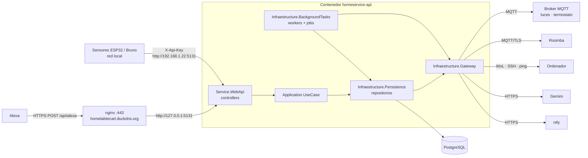
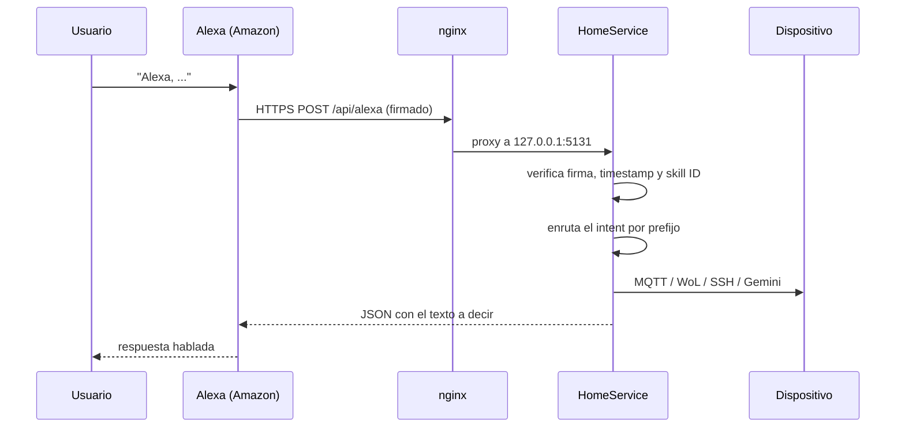
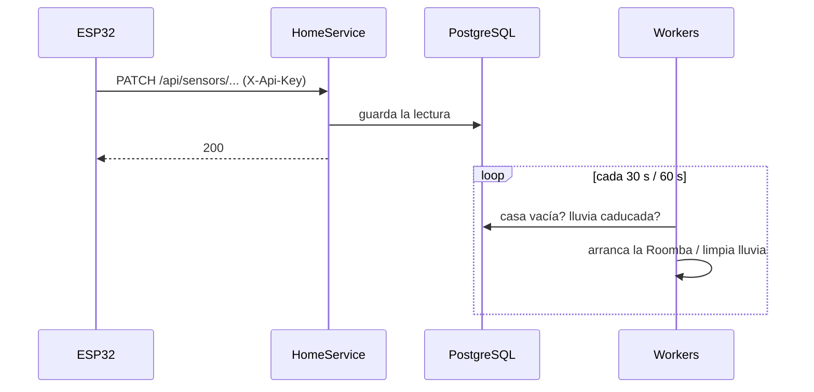

# HomeService

API de domótica para el homelab. Recibe órdenes de voz desde una skill de **Alexa** y controla la Roomba, las luces, el termostato y el ordenador de casa. También recoge datos de sensores ESP32 de presencia, lluvia y temperatura. Las preguntas que no son órdenes se responden con **Gemini**.

Hecho con **ASP.NET Core (.NET 10)** + **EF Core / Npgsql** sobre **PostgreSQL**, con arquitectura por capas. Es el port a C# de la versión Python ([homeservice2](https://github.com/marcosremon/homeservice2)), que sirve de referencia de comportamiento.

## Funcionalidades

- **Alexa**: endpoint de skill con verificación de firma de Amazon. Enruta cada intent al servicio correspondiente por prefijo (`roomba_order_`, `light_order_`, `temperature_sensor_order_`, `computer_status_order_`).
- **Asistente conversacional**: el intent `ConversationIntent` pasa la pregunta a Gemini, mantiene el historial en la sesión de Alexa y devuelve respuestas pensadas para leerse en voz alta.
- **Roomba**: control directo por MQTT/TLS contra el robot (iniciar, pausar, reanudar y enviar a la base), limpieza por habitaciones o de la casa completa, e inicio con temporizador.
- **Limpieza automática**: si los sensores de presencia indican que la casa está vacía, la Roomba arranca sola una vez al día entre las 08:00 y las 21:00, siempre que no esté atascada ni ya en marcha.
- **Luces**: encendido y apagado publicando en topics MQTT.
- **Termostato**: subir o bajar grados por zona, enviando el cambio relativo por MQTT sin `retain`.
- **Ordenador**: encendido por Wake-on-LAN, apagado por SSH (`systemctl poweroff`) y consulta de estado por ping.
- **Sensores**: registro y actualización de sensores de presencia, lluvia y temperatura. El estado de lluvia caduca a los 5 minutos sin detección.
- **Notificaciones push** al móvil vía [ntfy](https://ntfy.sh).

## Stack

| | |
|---|---|
| Lenguaje | C# / .NET 10 |
| API | ASP.NET Core (controllers), Microsoft.AspNetCore.OpenApi |
| Persistencia | PostgreSQL, EF Core + Npgsql, migraciones propias con SQL a mano (`DatabaseMigrator`) |
| Integraciones | MQTTnet, HttpClient, `ping` / `ssh` del sistema |
| Configuración | `Settings` propio que lee `.env` + variables de entorno |
| Tests | xUnit, Moq, EF Core InMemory, `WebApplicationFactory` |
| Testing de API | Colección [Bruno](https://www.usebruno.com/) en `bruno/` |
| Despliegue | Docker en la Raspberry Pi, nginx delante para Alexa |

## Arquitectura



```
HomeService.Service.WebApi/               # Program.cs y controllers
HomeService.Application.UseCase/          # casos de uso
HomeService.Application.Interface/        # interfaces de repositorios y servicios
HomeService.Application.DataTransferObject/
HomeService.Application.Event/
HomeService.Domain.Model/                 # entidades y enums
HomeService.Infraestructure.Gateway/      # Alexa, Gemini, MQTT, Roomba, luces, termostato, PC, ntfy
HomeService.Infraestructure.Persistence/  # DbContext, repositorios, DI de toda la solución y migraciones
HomeService.Infraestructure.BackgroundTasks/  # PresenceSensorMonitor, RainSensorMonitor, RoombaActivationHandler
HomeService.Transversal.Common/           # Settings, utils
HomeService.Transversal.Security/         # ApiKeyAuth y verificación de Alexa
HomeService.Transversal.JsonInterchange/  # contratos JSON de la API
HomeService.Transversal.Wrapper/          # BaseResponse y payloads de Alexa
HomeService.Service.UnitTests/
bruno/                                    # colección de peticiones
docs/                                     # decisiones (ADR) y runbooks
```

Al arrancar, `DatabaseMigrator` aplica las migraciones pendientes (tabla `database_version`) y se lanzan los workers en segundo plano:

- `PresenceSensorMonitor`: cada 30 s mira si la casa está vacía y, si lo está, arranca la Roomba.
- `RainSensorMonitor`: cada 60 s da por terminada la lluvia de los sensores sin detección en los últimos 5 minutos.

## Flujos

### Orden de voz



### Sensor ESP32



## Seguridad

- Todos los endpoints salvo `/api/alexa` exigen la cabecera `X-Api-Key`, comparada en tiempo constante. Si no hay clave configurada, el servidor rechaza la petición en lugar de dejarla pasar.
- `/api/alexa` valida la cadena de certificados, la firma y el timestamp de Amazon, además del skill ID.
- `X-Debug-Key` permite saltarse la verificación en pruebas manuales. Solo funciona si `DEBUG_BYPASS_KEY` está definida.
- Los comandos del sistema (`ping`, `ssh`) se lanzan sin shell y con IP y usuario validados.
- Desde internet solo se expone `POST /api/alexa` (nginx). El resto de rutas devuelven `403` fuera de la red local; para usarlas desde fuera, conectarse por la VPN de WireGuard.
- Los secretos van en `.env` o en variables de entorno y nunca se versionan.

## Puesta en marcha

### Requisitos

- .NET 10 SDK (o solo Docker para el despliegue)
- PostgreSQL con la base de datos ya creada (las tablas las crean las migraciones)
- Broker MQTT para luces y termostato
- Para el control del ordenador:
  - Wake-on-LAN activado en el equipo.
  - Clave SSH en `~/.ssh/homelab_key`.
  - Un usuario con `sudo systemctl poweroff` sin contraseña.
- Opcional: skill de Alexa, API key de Gemini, topic de ntfy y credenciales locales de la Roomba

### Configuración (`.env`)

```bash
cp .env.example .env
```

| Variable | Descripción |
|---|---|
| `APP_HOST` / `APP_PORT` | Informativos: Kestrel escucha lo que diga `ASPNETCORE_URLS` |
| `DATABASE_URL` | Cadena de Npgsql: `Host=host;Port=5432;Database=base_de_datos;Username=usuario;Password=password` |
| `INTERNAL_API_KEY` | Clave para `X-Api-Key` (obligatoria). Genera una con `openssl rand -hex 32` |
| `DEBUG_BYPASS_KEY` | Clave para `X-Debug-Key` (vacía = bypass desactivado) |
| `ALEXA_SKILL_ID` / `ALEXA_VERSION` | ID de la skill en la consola de Amazon |
| `GEMINI_API_KEY` / `GEMINI_MODEL` | Credenciales de Google AI Studio (por defecto `gemini-2.5-flash`) |
| `ROOMBA_ID`, `ROOMBA_PORT`, `ROOMBA_BLID`, `ROOMBA_PASSWD`, `ROOMBA_PMAP_ID`, `ROOMBA_PMAP_VERSION` | Conexión local con la Roomba y mapa |
| `MQTT_HOST`, `MQTT_PORT`, `MQTT_USER`, `MQTT_PASSWORD` | Broker MQTT |
| `NTFY_BASE_URL` / `NTFY_TOPIC` | Notificaciones push (sin topic se desactivan) |
| `LAN_BROADCAST_IP`, `LAN_COMPUTER_IP`, `LAN_COMPUTER_MAC`, `LAN_CACHYOS_USER` | Wake-on-LAN y apagado por SSH |
| `LOG_LEVEL` | Nivel de log |

`DATABASE_URL` e `INTERNAL_API_KEY` son obligatorias: sin ellas la app no arranca. En Docker no hace falta que el `.env` esté dentro de la imagen: se inyecta con `env_file` y las variables de entorno tienen prioridad.

### Ejecutar en local

```bash
dotnet build HomeService.Service.WebApi.slnx
dotnet run --project HomeService.Service.WebApi
```

Escucha en `http://localhost:5279` y en Development publica la especificación OpenAPI en `/openapi/v1.json`.

> Con el `.env` real la app actúa sobre dispositivos de verdad y el migrador toca la BBDD. Para probar sin riesgo: [`docs/runbooks/probar-en-local.md`](docs/runbooks/probar-en-local.md).

### Tests

```bash
dotnet test HomeService.Service.WebApi.slnx
```

## Despliegue (Raspberry Pi)

| Qué | Dónde |
|---|---|
| Código | `~/proyects/homeservice` |
| `.env` real | `~/proyects/homeservice/.env` |
| `docker-compose.yml` | `~/docker/homeservice/` |
| `Dockerfile` | `~/docker/homeservice/api/Dockerfile` |
| Script de actualización | `~/proyects/homeservice/shell-scripts/update-homeservice.sh` |
| nginx (Alexa) | `/etc/nginx/sites-available/homelab` |

- El contenedor `homeservice-api` usa `network_mode: host` y escucha en `:5131`.
- El `Dockerfile` compila con `mcr.microsoft.com/dotnet/sdk:10.0` y ejecuta con `mcr.microsoft.com/dotnet/aspnet:10.0`, con `iputils-ping` y `openssh-client` instalados.
- La clave SSH se monta en `/root/.ssh/homelab_key` (solo lectura).
- `restart: unless-stopped`.

### Actualizar

```bash
cd ~/proyects/homeservice && git pull
~/proyects/homeservice/shell-scripts/update-homeservice.sh
```

El script hace `docker compose down` y `docker compose up -d --build` desde `~/docker/homeservice`.

### Comprobar que está bien

```bash
docker ps --filter name=homeservice-api      # STATUS "Up", COMMAND "dotnet HomeService…"
docker logs --tail 20 homeservice-api        # "BBDD al dia" y "Now listening on: http://0.0.0.0:5131"
docker logs -f homeservice-api               # en directo
```

Desde la red local:

```bash
curl -i -H "X-Api-Key: <INTERNAL_API_KEY>" http://192.168.1.22:5131/api/change-computer-status/get-computer-status
```

Por el dominio (solo Alexa; `-k` porque nginx usa un certificado autofirmado):

```bash
curl -k -i -X POST https://homelabteruel.duckdns.org/api/alexa -H 'Content-Type: application/json' -d '{}'
```

`401` con un JSON de Alexa significa que llegó a la API y rechazó la petición por no ir firmada: todo correcto. `502` significa que el contenedor está caído.

## Endpoints

Todas las rutas llevan el prefijo `/api`.

| Método | Ruta | Descripción | Acceso |
|---|---|---|---|
| `POST` | `/alexa` | Entrada de la skill de Alexa | Dominio HTTPS |
| `GET` | `/change-computer-status/turn-on-computer` | Wake-on-LAN | LAN |
| `GET` | `/change-computer-status/turn-off-computer` | Apagado por SSH | LAN |
| `GET` | `/change-computer-status/get-computer-status` | Estado por ping | LAN |
| `POST` | `/roomba/create-roomba` | Registrar Roomba | LAN |
| `PATCH` | `/roomba/patch-roomba-state` | Actualizar estado | LAN |
| `POST` | `/sensor/presence-sensor/create-presence-sensor` | Registrar sensor de presencia | LAN |
| `PATCH` | `/sensor/presence-sensor/patch-presence-sensor-data` | Enviar lectura de presencia | LAN |
| `POST` | `/sensors/temperature-sensor/create-temperature-sensor` | Registrar sensor de temperatura | LAN |
| `PATCH` | `/sensors/temperature-sensor/patch-temperature-sensor` | Enviar lectura de temperatura | LAN |
| `POST` | `/sensors/rain-sensor/create-rain-sensor` | Registrar sensor de lluvia | LAN |
| `PATCH` | `/sensors/rain-sensor/patch-rain-sensor` | Enviar detección de lluvia | LAN |

Las rutas y claves JSON no se tocan, erratas incluidas (`/sensor/presence-sensor` en singular): las usan los ESP32 y Amazon tal cual.

### Bruno

Abre `bruno/` en Bruno y elige un entorno:

| Entorno | `baseUrl` | Para qué |
|---|---|---|
| `Local` | `http://127.0.0.1:5099` | App de pruebas, sin dispositivos reales |
| `Casa` | `http://127.0.0.1:5131` | La app de verdad, desde la red local |
| `Dominio` | `https://homelabteruel.duckdns.org` | Solo la carpeta Alexa (desactiva la verificación SSL en Preferences) |

`apiKey` y `debugKey` son variables secretas: se rellenan en Bruno y no se guardan en el repo. Con `Casa` y `Dominio` las peticiones actúan de verdad sobre luces, Roomba, termostato y ordenador.

## Topics MQTT

| Topic | Payload |
|---|---|
| `home/<zona>/lights/cmd` | `ON` / `OFF` (o el `mqtt_topic` propio de la luz si está definido) |
| `home/<zona>/thermostat/cmd` | Incremento relativo, p. ej. `+2` / `-1` (sin `retain`) |

## Pendiente

- Luces: `LightController` sin portar.
- «Enciende/apaga el ordenador» por voz solo consulta el estado; el encendido real está en `/api/change-computer-status`.
- `CreatePresenceSensor` no comprueba duplicados.

## Autor

**Marcos** — [@marcosremon](https://github.com/marcosremon)
